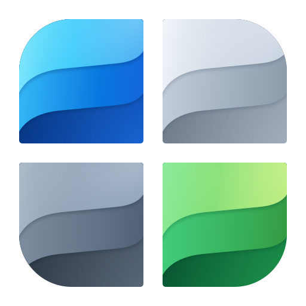

# Выписки ЕГРН · WinUI 3



[](https://github.com/lawlabs/rosreestr-xml-viewer-winui/actions/workflows/ci.yml)
[](LICENSE)

Локальное Windows-приложение для просмотра и пакетной работы с выписками ЕГРН. Новая реализация сценариев Delphi-приложения `rosreestr-xml-viewer-delphi` на C#, WinUI 3, Windows App SDK и .NET 10: табличные печатные формы, исходные PDF, схемы, извлечение кадастровых номеров и сравнение списков.

**Статус: первая версия для разработки и проверки.** Это независимое приложение, не официальный продукт Росреестра. Поддержка отдельных форматов и наличие подписи не означают юридической или криптографической проверки документа. Подписанный установщик пока не опубликован; ниже описан запуск из исходников.

В репозитории нет пользовательских выписок. Демонстрационные документы содержат вымышленные сведения. Исходные документы при просмотре не изменяются и автоматически на сервер не отправляются.

## Сборка и запуск

Для разработки нужны Windows, [.NET 10 SDK](https://dotnet.microsoft.com/download/dotnet/10.0), инструменты C# / WinUI и Windows SDK, [WinApp CLI](https://github.com/microsoft/WinAppCli) 0.7.1+ и Edge WebView2 Runtime. SDK задаётся в `global.json` с возможностью использовать более новый стабильный feature band .NET 10. Версии NuGet-зависимостей указаны в проектах.

```powershell
git clone https://github.com/lawlabs/rosreestr-xml-viewer-winui.git
cd rosreestr-xml-viewer-winui
dotnet build .\RosreestrViewer.csproj -p:Platform=x64
dotnet run --project .\Tests\RosreestrViewer.Core.Tests.csproj
winapp run .\RosreestrViewer.csproj --detach --json
```

Это **packaged** приложение: WinApp CLI выполняет сборку, регистрацию разработческого пакета и запуск с идентификатором Windows. Прямой запуск EXE из `bin` не заменяет регистрацию пакета. Минимальная версия в манифесте — Windows 10 1809; фактическая совместимость также зависит от выбранных версий Windows App SDK и WebView2 и требует проверки на целевой системе. Release trimming отключён; Native AOT не заявляется. Для обычной сборки предыдущий Delphi-проект и личный набор выписок не нужны.

## Работа

- **Открыть**: несколько XML, ZIP или PDF; также работает перетаскивание файлов.
- **Папка**: файлы непосредственно в выбранной папке. Подпапки автоматически не обходятся; максимум 1000 файлов за один импорт.
- **Пример**: четыре XML с вымышленными данными, включая документ для архивной табличной формы. Это примеры интерфейса, а не эталоны официальных XSD.
- **Мои выписки**: поиск по кадастровому номеру, адресу, виду, имени файла и извлечённым правообладателям. Точные дубликаты документа и объекта объединяются по SHA-256 и номеру.
- **Карточка**: основные сведения, права, ограничения, источник и предупреждения. Отсутствие извлечённой записи не означает отсутствие права.
- **Печатная форма**: исходный XML преобразуется локально по версионному XSL. Сохраняются таблицы, объединённые ячейки и оформление шаблона. Подключены четыре архивных пакета Росреестра и четыре сторонних пакета из старого проекта; источник указан над формой. Для неизвестной версии показывается причина, карточка не подставляется вместо документа.
- **PDF из пакета**: связанный `document.pdf` / `document.xml.pdf` показывается без преобразования. Если найдено несколько разных PDF, доступен выбор файла. При повторном импорте одинакового XML новые доступные вложения добавляются в существующую строку. PDF с другим именем в ZIP остаётся отдельным документом, без предположения о связи с XML.
- **Схема**: отдельные контуры и каталог координат; разные системы координат разделяются. У открытого контура площадь не вычисляется. Приложение не восстанавливает план квартиры по адресу или площади.
- **Вложения**: доступные изображения, PDF, подпись и ссылки из XML. Внутренние серверные пути отмечаются отдельно. ZIP читается в памяти без распаковки в папку пользователя.
- **Поля XML / Исходник**: полный список сохранённых полей и текст документа. Индексы различают повторяющиеся узлы. При сохранении исходника записываются исходные байты.
- **Реестр CSV**: экспорт текущей поисковой выборки в UTF-8 с BOM, разделитель `;`, нейтрализация формул в текстовых ячейках.
- **PDF / печать**: выбрать исходный PDF, печатную форму по XSL или краткий отчёт A4. Печатные формы и исходные PDF для всей выборки сохраняются отдельными файлами в папку; отчёт — одним файлом. Один исходный XML с несколькими объектами даёт одну форму целого документа. Неподдержанные формы пропускаются с сообщением, без замены карточкой.
- **Сравнить**: выбрать две выписки с Ctrl. Можно также выбрать выписки в диалоге команды без Ctrl. Сравнение полей учитывает связь повторяющихся записей через индексы; перестановка записей тоже показывается как изменение.
- **… → Списки кадастровых номеров**: вставить два произвольных текста или один список для извлечения. Отчёт показывает оба набора, номера только в первом, только во втором и общие, с количеством уникальных номеров. Пробелы вокруг двоеточий и повторы не влияют на сравнение; ведущие нули сохраняются. Это извлечение номеров из текста, без проверки существования объекта в ЕГРН.
- В меню **…**: сохранение печатной формы HTML со встроенными изображениями, каталог XSL с источниками, извлечение и сравнение списков кадастровых номеров, сохранение оригинала, экспорт схемы SVG, проверка по локальной XSD, восстановление последней сессии, тема, отмена импорта и проверка подписи через официальный сервис.
- **НСПД**: открывает публичную кадастровую карту в браузере и копирует номер выбранного объекта для поиска. Недокументированные параметры поиска и API карты не используются.

## Что поддержано и что требует проверки

Разбираются известные узлы современных семейств `extract_about_property_*`, `extract_base_params_*`, перехода прав, КПТ, уведомлений об отсутствии сведений и старых `Extract`, `KPOKS`, `KVOKS`, `KVZU`. Проверены реальные пользовательские документы этих семейств; это не утверждение о полной поддержке всех действующих версий XSD. Неизвестные поля сохраняются в просмотре XML. Карточка не воспроизводит всю официальную печатную форму.

Поддержка извлечения данных и поддержка печатной формы различаются. Версии, происхождение и адаптации XSL описаны в [Templates/SOURCES.md](Templates/SOURCES.md). Старые графические JavaScript-сценарии отключены; таблицы и CSS сохраняются. Наличие архивного шаблона не гарантирует совпадение с действующей формой или переносами страниц официального PDF. Точное сохранение внешнего вида обеспечивает исходный PDF из пакета.

Готовая графика предпочтительна, когда она присутствует в пакете. Прямые HTTPS-ссылки с официальных доменов можно загрузить отдельной командой; результаты кэшируются. Внутренние пути вида `/10.x.x.x/...` и `.../EXT_FILE` не являются публичным API. По ним нельзя обещать получение изображения с сайта. Координаты МСК не переводятся в WGS84 без параметров преобразования. Площади отображаются в исходных единицах; отверстия и топология объединения контуров не вычисляются.

SIG/P7S сопоставляются по имени исходника; **наличие подписи не означает, что она проверена**. Локальная ГОСТ-проверка, цепочка сертификатов, отзыв и доверенная метка времени пока не реализованы. Для проверки доступна ссылка на Госуслуги. Для XSD выберите файл и корневую папку всего распакованного пакета, включая `SchemaCommon`: зависимости разрешены внутри этого пакета, сетевые импорты отключены. Успех проверки относится к выбранной XSD, а не к подписи или актуальности схемы.

Пределы: XML 32 МБ, вложение/PDF 24 МБ, ZIP 4096 записей и 256 МБ суммарно после распаковки, XML 100000 полей / 128 уровней. Вложенные архивы не раскрываются. Для многотысячного постоянного каталога нужен следующий этап с дисковым индексом и ленивой загрузкой документов; текущая сессия держит открытые документы в памяти. TIFF можно сохранить для открытия во внешнем приложении. Изображения PNG/JPEG/GIF/BMP и PDF доступны в предпросмотре.

## Хранение

`LocalCache\Local\RosreestrViewer` внутри папки пакета Windows: список путей последней сессии, кэш графики и профиль WebView2. Предпросмотр создаётся в отдельной папке с GUID и удаляется при обычном закрытии окна; после аварийного завершения временная папка может остаться. Исходные файлы не отправляются на сервер автоматически. Встроенный просмотр использует локальные подготовленные страницы, CSP и отключённые скрипты/host objects.

## Проверки

```powershell
dotnet build .\RosreestrViewer.csproj -p:Platform=x64
dotnet run --project .\Tests\RosreestrViewer.Core.Tests.csproj
dotnet run --project .\Tests\RosreestrViewer.Core.Tests.csproj -- --audit 'C:\Extracts'
dotnet run --project .\Tests\RosreestrViewer.Core.Tests.csproj -- --forms 'C:\Extracts'
winapp run .\RosreestrViewer.csproj --detach --json --args '--test-profile'
.\scripts\ui-tests.ps1 -AppPid <ProcessId тестового окна>
.\scripts\ui-printing-tests.ps1 -AppPid <ProcessId того же тестового окна>
.\scripts\ui-cadastral-lists-tests.ps1 -AppPid <ProcessId тестового окна>
```

`Tests` — исполняемый набор проверок без стороннего тестового фреймворка, с ненулевым кодом выхода при ошибке. GitHub Actions собирает приложение Release x64 на Windows и запускает эти проверки; интерактивные UI-сценарии выполняются отдельно на Windows с рабочим столом.

`C:\Extracts` в командах аудита — пример пути к вашему локальному набору; такой набор в репозиторий не входит. Аудит читает файлы на месте и сохраняет только обезличенные количества в `artifacts/corpus-audit.json`. UI Automation проверяет реальное окно, поиск, схемы, поля, исходник, сравнение и темы. Отчёты и снимки остаются в локальной папке `artifacts/`, полностью исключённой из Git.

Исследование старого приложения, источники и решения: [docs/RESEARCH.md](docs/RESEARCH.md). Архитектура и дальнейшие необходимые этапы: [docs/ARCHITECTURE.md](docs/ARCHITECTURE.md).

## Участие и лицензия

Ошибки и предложения можно отправлять в [Issues](https://github.com/lawlabs/rosreestr-xml-viewer-winui/issues). **Не прикладывайте настоящие выписки, подписи или персональные данные.** Для воспроизведения используйте минимальные синтетические примеры. Порядок работы — [CONTRIBUTING.md](CONTRIBUTING.md).

Собственный код проекта распространяется по [MIT](LICENSE). Архивные XSL/XML/XSD и зависимости сохраняют свои условия; источники и исключения перечислены в [THIRD_PARTY_NOTICES.md](THIRD_PARTY_NOTICES.md). Исходники значка и обновление размеров — [Assets/Branding/README.md](Assets/Branding/README.md).
